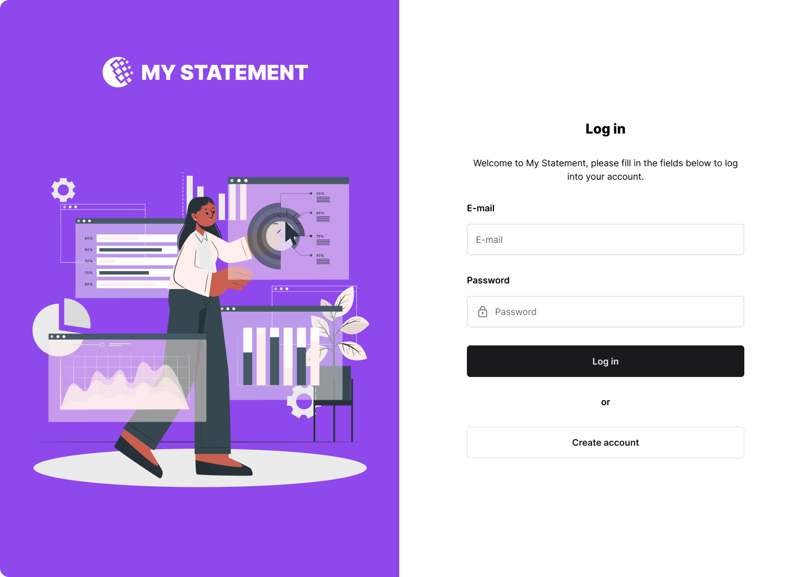

[](https://codecov.io/gh/micheltlutz/dev-challenge)
[](https://codebeat.co/projects/github-com-micheltlutz-dev-challenge-main)


# Development challenge

A practice lab for web, mobile, back-end and fullstack developers. Twenty
challenges built around one product: a personal-banking dashboard called **My
Statement**.

What makes it a lab rather than a list of exercises:

- **A real API to build against**, hosted or in Docker, with seeded data.
- **A real design** — Figma, plus design tokens on disk so you do not need
  Figma access to build faithfully.
- **Executable specifications.** Every challenge has numbered acceptance
  criteria, and the API contract is regenerated and checked by CI, so the spec
  can never quietly disagree with the API again.
- **A verification harness.** Point it at what you built and it tells you which
  criteria you have met.
- **Agent instructions.** Working with Claude Code, Copilot or Cursor is a real
  skill; the repo ships the context they need, set to coach rather than to hand
  you the answer.

## Pick your door

### I want to do the challenges

**➡️ [Challenger guide](readme_files/challenged.md)** · [All challenges](specs/README.md)

You work in **your own repository** — no need to fork this one. Nothing below
requires cloning.

**1. Get an API to build against.** Use the hosted one at
`https://dev-challenge.micheltlutz.me` ([docs](https://dev-challenge.micheltlutz.me/docs)),
or run your own:

```bash
docker run -d -p 8000:8000 ghcr.io/micheltlutz/dev-challenge:latest
```

**2. Pick a challenge** from [`specs/`](specs/README.md) and build it.

**3. Check your work** against its acceptance criteria:

```bash
# Linux
docker run --rm --network host ghcr.io/micheltlutz/dev-challenge-harness \
  --base-url http://localhost:3000 --challenge backend-05-balance

# macOS / Windows (--network host does not bridge to the host there)
docker run --rm ghcr.io/micheltlutz/dev-challenge-harness \
  --base-url http://host.docker.internal:3000 --challenge backend-05-balance
```

```
PASS  BE05-AC1  Unauthenticated request is rejected
FAIL  BE05-AC3  Seeded balance is exact
      └─ john.doe@email.com should have a balance of 15491.00, got 13512.59.
SKIP  BE05-AC5  Deposit increases the balance
      └─ Cannot create statements (POST /statement/ returned 404).

2/7 criteria passed
```

`--list` shows every challenge id. Drop `--challenge` to run them all.

### I want to improve the project

**➡️ [Contributing](CONTRIBUTING.md)** · [Local setup](readme_files/contributors.md) · [Roadmap](ROADMAP.md)

```bash
python -m venv venv && source venv/bin/activate
pip install -r requirements_for_dev.txt
python scripts/seed.py
uvicorn app.main:app --reload
```

### I am a coding agent

**➡️ [`AGENTS.md`](AGENTS.md)** — plus [`CLAUDE.md`](CLAUDE.md),
[`.github/copilot-instructions.md`](.github/copilot-instructions.md) and
[`.cursor/rules/`](.cursor/rules/).

Claude Code users get `/challenge <id>`, `/verify` and `/next`, three skills and
two subagents. The default posture is **mentor, not solver** — it plans and
reviews with you rather than writing the challenge for you. Ask it directly and
it will switch; the escape hatch is documented, not hidden.

## The challenges

| Track | What you do | Count | Verified |
|---|---|---|---|
| [Back-end](specs/README.md#back-end--reimplement-the-api-in-your-language) | Reimplement the API in your language | 6 | automatically |
| [Web](specs/README.md#web--build-the-interface-against-the-provided-api) | Build the interface against the provided API | 6 | automatically (Playwright) |
| [Mobile](specs/README.md#mobile--build-the-native-app-against-the-provided-api) | Build the native app against the provided API | 5 | self-review |
| [Fullstack](specs/README.md#fullstack--own-both-ends-of-the-contract) | Own both ends of the contract | 3 | automatically |

Each runs from `starter` to `advanced` and declares its prerequisites, so you
can climb a track or jump in where you are useful.

## How it fits together

```
app/ (reference API)
  └─ scripts/export_openapi.py ──→ specs/openapi.json ──┐
                                                         ├─→ specs/challenges/<id>/
Figma + mockups ──→ specs/design/tokens.json ───────────┘         │
                                                                  ├─→ harness/
                                                                  └─→ AGENTS.md
```

Every arrow is enforced by CI. `specs/` is the source of truth — not the code,
and not the prose. That is deliberate: the old briefs told challengers to call
`POST /create_contact` with a field named `nome` while the API served
`POST /contact/` with `name`, so the first request anyone made returned a 422
for reasons the documentation could not explain. Now a spec that disagrees with
the API fails the build.

See [`specs/README.md`](specs/README.md).

## The design

Screen flows, components and a style guide by
[Aline Moraes](https://www.linkedin.com/in/alinegermanodemoraes/).

- **Figma:** [Desafio para devs - App / Dashboard | UX/UI](https://www.figma.com/file/Q44nlEVrODE7W6iBFRVPZL/Desafio-para-devs---App-%2F-Dashboard-%7C-UX%2FUI?node-id=1-655)
- **Without Figma:** [style guide](specs/design/style-guide.md) · [tokens](specs/design/tokens.css) · [screens](specs/design/screens.md)

| | |
|---|---|
|  |  |

## Demo data

Both users have the password `Challenge@123`:

| User | Statements | Balance |
|---|---|---|
| `john.doe@email.com` | 5 | 15491.00 |
| `jane.roe@email.com` | 1 | 4200.00 |

Plus 40 statements belonging to neither — which is what makes the per-user
scoping criteria worth checking. Rebuild any time with `python scripts/seed.py`.

## Show your work

Finished something? Open a
[Submit your solution](https://github.com/micheltlutz/dev-challenge/issues/new/choose)
issue and it gets linked from [`SOLUTIONS.md`](SOLUTIONS.md).

## Non-profit project

Built voluntarily, to support people who want to sharpen their skills. Please
do not use it commercially. Use it for your team, your mentoring and your
students — and where you can, credit it.

It is a **teaching lab**, not production software, and some simplifications are
deliberate. See [`SECURITY.md`](SECURITY.md) before deploying anything from it.

## License

[MIT](LICENSE).
