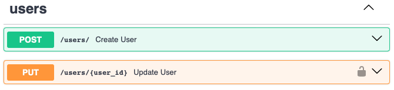
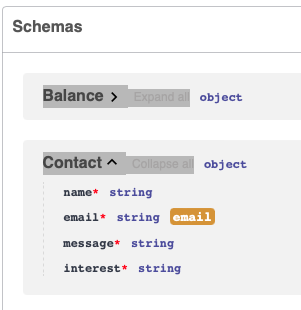

# Instructions for challengers

Everything you need to start: an API to build against, a design to build to, and
a harness that tells you when you are done.

## 1. Get an API

You need the reference API running somewhere. Pick the cheapest option that
works for you.

### Option A — use the hosted one (nothing to install)

```
https://dev-challenge.micheltlutz.me
```

Docs: <https://dev-challenge.micheltlutz.me/docs>

Good for front-end and mobile work. Note it is a **shared** instance — register
your own account rather than relying on the demo data staying pristine.

### Option B — Docker

```bash
docker build -t dev-challenge .
docker run -d --name dev-challenge-demo -p 8000:8000 dev-challenge:latest
```

Then <http://localhost:8000/docs>. Stop it with
`docker stop dev-challenge-demo`.

Or, with compose:

```bash
docker compose up
```

**Requirements:** Docker Engine on Linux, [Rancher
Desktop](https://docs.rancherdesktop.io/getting-started/installation) on macOS
and Windows (free, and more complete than the alternatives). On Windows you
also need [WSL2](https://learn.microsoft.com/en-us/windows/wsl/install), and
you must run the terminal as administrator.

### Option C — Python

See [contributors.md](contributors.md).

## 2. Log in with the demo data

Two seeded accounts, both with the password `Challenge@123`:

| User | Statements | Balance |
|---|---|---|
| `john.doe@email.com` | 5 | 15491.00 |
| `jane.roe@email.com` | 1 | 4200.00 |

The database also holds 40 statements belonging to neither. If those show up in
either user's results, something is scoping data wrong.

Get a token:

```bash
curl -X POST http://localhost:8000/auth/ \
  -H 'Content-Type: application/json' \
  -d '{"userid":"john.doe@email.com","password":"Challenge@123"}'
```

Then send it as `Authorization: Bearer <access_token>` on protected routes.
In Swagger UI those carry a padlock:





## 3. Pick a challenge

All challenges live in **[`specs/`](../specs/README.md)** with numbered
acceptance criteria.

| Track | What you do | Start at |
|---|---|---|
| **Back-end** | Reimplement the API in your language | [`backend-01-contact`](../specs/challenges/backend-01-contact/spec.md) |
| **Web** | Build the interface against the provided API | [`web-01-contact-form`](../specs/challenges/web-01-contact-form/spec.md) |
| **Mobile** | Build the native app against the provided API | [`mobile-01-create-account`](../specs/challenges/mobile-01-create-account/spec.md) |
| **Fullstack** | Own both ends of the contract | [`fullstack-01-contact`](../specs/challenges/fullstack-01-contact/spec.md) |

The full index, with difficulty and time estimates, is in
[`specs/README.md`](../specs/README.md).

## 4. Read the design

Front-end and mobile challenges are built to a real design.

- **Figma:** [Desafio para devs - App / Dashboard | UX/UI](https://www.figma.com/file/Q44nlEVrODE7W6iBFRVPZL/Desafio-para-devs---App-%2F-Dashboard-%7C-UX%2FUI?node-id=1-655)
- **Without Figma:** [`specs/design/style-guide.md`](../specs/design/style-guide.md)
- **Tokens you can import:** [`specs/design/tokens.css`](../specs/design/tokens.css)
- **Screen inventory:** [`specs/design/screens.md`](../specs/design/screens.md)

Each challenge deep-links to its own Figma node.

## 5. Build in your own repository

Create your own repo. You are not expected to fork this one.

Your project should have a README saying how to run it, what you chose, and
why. That reasoning is part of what you are demonstrating.

## 6. Verify

This is the part that makes it a lab rather than a reading list. The harness
checks your work against the same acceptance criteria the spec lists:

```bash
# Linux
docker run --rm --network host ghcr.io/micheltlutz/dev-challenge-harness \
  --base-url http://localhost:3000 --challenge backend-05-balance

# macOS / Windows (--network host does not bridge to the host there)
docker run --rm ghcr.io/micheltlutz/dev-challenge-harness \
  --base-url http://host.docker.internal:3000 --challenge backend-05-balance
```

You get a scorecard per criterion, with the criterion's text next to the
result. See [`harness/README.md`](../harness/README.md) for the web UI runner
and the other options.

Mobile challenges are self-reviewed — native UI cannot be checked the same way.
Each mobile spec says so plainly.

## 7. Working with a coding agent

Using Claude Code, Copilot or Cursor on these challenges is encouraged — being
good at that is a real skill now. The repo ships instructions so your agent
understands the spec layer: see [`AGENTS.md`](../AGENTS.md).

By default the agent behaves as a **mentor**: it plans with you, reviews your
code and explains failing criteria, but does not hand you the implementation.
If you would rather study a worked solution, ask it directly — the escape hatch
is documented, not hidden.

## 8. Share it

Open a [Submit your solution](https://github.com/micheltlutz/dev-challenge/issues/new/choose)
issue and your repo gets linked from `SOLUTIONS.md`.

---

**Found a mistake in a spec?** That is a real contribution —
[open an issue](https://github.com/micheltlutz/dev-challenge/issues/new/choose).
The specs are verified against the API by CI, but wording and intent still need
human eyes.
