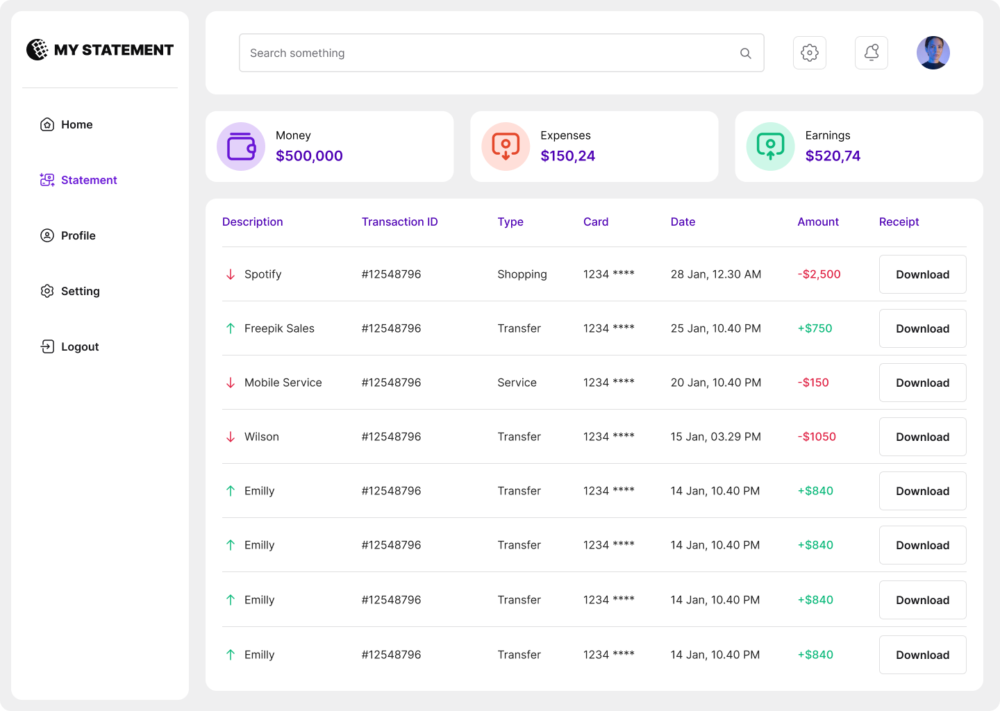
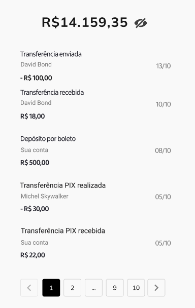

# Statement and balance, end to end

**Track:** fullstack · **Difficulty:** advanced · **Estimated:** 10h  
**Prerequisites:** [`fullstack-02-auth`](../fullstack-02-auth/spec.md)

## Objective

The capstone. Own the data model, the balance rules, per-user scoping, the
paginated API, and the screen that renders it all.

## Design

[Open this screen in Figma](https://www.figma.com/file/Q44nlEVrODE7W6iBFRVPZL/Desafio-para-devs---App-%2F-Dashboard-%7C-UX%2FUI?node-id=13-5855)




Design system: [`../../design/style-guide.md`](../../design/style-guide.md) · tokens: [`../../design/tokens.json`](../../design/tokens.json)

## What you build

| Half | From |
|---|---|
| API | [`backend-04-statements`](../backend-04-statements/spec.md) + [`backend-05-balance`](../backend-05-balance/spec.md) |
| UI | [`web-05-statement`](../web-05-statement/spec.md) |

## What makes this the capstone

You own the seed data too. Your database must contain at least two users with
**different, non-overlapping ledgers**, because the criteria that matter most
here are the scoping ones — a user must never see another user's rows or
balance.

Reproduce the reference fixture so the numbers are checkable:

| User | Statements | Balance |
|---|---|---|
| `john.doe@email.com` | 5 | 15491.00 |
| `jane.roe@email.com` | 1 | 4200.00 |

Both with the password `Challenge@123`. See
[`scripts/seed.py`](../../../scripts/seed.py) in this repo for the exact rows,
and provide an equivalent seeding command in your own project.

## Balance rules

| Type | Condition | Effect |
|---|---|---|
| `Deposit` | any | add |
| `Withdrawal` | any | subtract |
| `Transfer` | `to_user == from_user` | add |
| `Transfer` | `to_user != from_user` | subtract |

Applied to the caller's own statements only. A statement belongs to a user when
their full name is either `from_user` or `to_user`.

## Requirements

- Pagination via `skip` and `limit` query parameters, `limit` bounded to 1..100.
- The hide-values toggle from the wireframe, persisted across reloads.
- Credit/debit distinguished by colour **and** by sign and arrow.
- A documented seeding command.

## Test IDs

Expose these as `data-testid` (web) or the platform accessibility identifier (mobile). They are the contract that lets the harness verify your UI without dictating your framework.

```
balance-amount
balance-toggle
statement-table
statement-row
statement-amount
pagination
pagination-next
pagination-prev
statement-empty
```

## Acceptance criteria

See [`acceptance.md`](acceptance.md) — 6 criteria (`FS03-AC1`…`FS03-AC6`).

## Verifying your work

```bash
# Linux
docker run --rm --network host ghcr.io/micheltlutz/dev-challenge-harness \
  --base-url http://localhost:8000 --challenge fullstack-03-statement

# macOS / Windows
docker run --rm ghcr.io/micheltlutz/dev-challenge-harness \
  --base-url http://host.docker.internal:8000 --challenge fullstack-03-statement
```

See [`../../../harness/README.md`](../../../harness/README.md) for the UI runner and other options.

## Final considerations

- Write a README that says how to run your project, what you chose and why.
- Handle the error paths, not just the happy one.
- Tests are not required, but they are the clearest signal you can send.
- If something in this spec is ambiguous or wrong, [open an issue](https://github.com/micheltlutz/dev-challenge/issues/new/choose) — fixing the spec is a real contribution.
