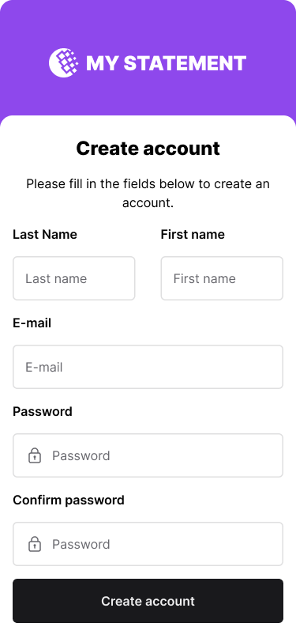

# Create account screen

**Track:** mobile · **Difficulty:** starter · **Estimated:** 4h  
**Prerequisites:** none — you can start here.

## Objective

Build the sign-up screen as a native mobile screen (375×812) and register the
user through the API.

## Design

[Open this screen in Figma](https://www.figma.com/file/Q44nlEVrODE7W6iBFRVPZL/Desafio-para-devs---App-%2F-Dashboard-%7C-UX%2FUI?node-id=1-655)



Design system: [`../../design/style-guide.md`](../../design/style-guide.md) · tokens: [`../../design/tokens.json`](../../design/tokens.json)

## What you build

The **Create account** screen from the mobile design. No split panel — the form
fills the screen, stacked vertically:

1. **Last Name**, **First name**
2. **E-mail**
3. **Password**
4. **Confirm password**
5. **Date of birth**

Primary button **Create account**, full width, `--color-action-default`. A link
to the login screen below it.

### On submit

```http
POST /users/
Content-Type: application/json

{
  "userid": "<e-mail>",
  "password": "<password>",
  "fullname": "<First name> <Last Name>",
  "birthdate": "YYYY-MM-DD"
}
```

201 → go to login. 400 → the e-mail is taken. 422 → per-field errors.

## Mobile requirements

- Use the platform's native date picker; convert to ISO on save.
- Set the correct keyboard type per field (e-mail keyboard for e-mail, secure
  entry for passwords).
- The keyboard must not cover the focused field — handle keyboard avoidance.
- Confirm password must match before anything is sent.

## Test IDs

Expose these as `data-testid` (web) or the platform accessibility identifier (mobile). They are the contract that lets the harness verify your UI without dictating your framework.

```
signup-form
signup-firstname
signup-lastname
signup-email
signup-password
signup-confirm-password
signup-birthdate
signup-submit
signup-error
signup-success
link-login
```

## Acceptance criteria

See [`acceptance.md`](acceptance.md) — 6 criteria (`MOB01-AC1`…`MOB01-AC6`).

## Verifying your work

⚠️ **This challenge is not automatically verified.** Native mobile UI cannot be checked the way an HTTP API or a browser page can, so the criteria in `acceptance.md` are a self-review checklist. Optional [Maestro](https://maestro.mobile.dev/) flows live in `harness/ui/mobile/` if you want to automate part of it.

## Final considerations

- Write a README that says how to run your project, what you chose and why.
- Handle the error paths, not just the happy one.
- Tests are not required, but they are the clearest signal you can send.
- If something in this spec is ambiguous or wrong, [open an issue](https://github.com/micheltlutz/dev-challenge/issues/new/choose) — fixing the spec is a real contribution.
