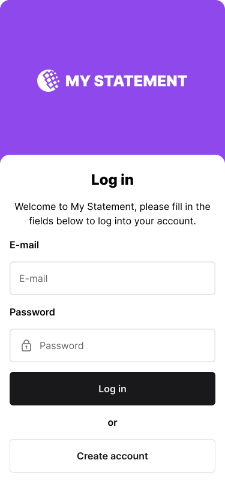

# Login screen

**Track:** mobile · **Difficulty:** intermediate · **Estimated:** 4h  
**Prerequisites:** [`mobile-01-create-account`](../mobile-01-create-account/spec.md)

## Objective

Build the login screen and establish a session that is stored **securely** —
this is the one place the mobile track genuinely differs from the web track.

## Design

[Open this screen in Figma](https://www.figma.com/file/Q44nlEVrODE7W6iBFRVPZL/Desafio-para-devs---App-%2F-Dashboard-%7C-UX%2FUI?node-id=1-731)



Design system: [`../../design/style-guide.md`](../../design/style-guide.md) · tokens: [`../../design/tokens.json`](../../design/tokens.json)

## What you build

The **Log in** screen from the mobile design: heading, e-mail field, password
field with the lock icon, near-black **Log in** button, `or` divider, outlined
**Create account** button.

### On submit

```http
POST /auth/
Content-Type: application/json

{ "userid": "<e-mail>", "password": "<password>" }
```

200 → store the token and go to the dashboard. 401 → show `Incorrect username
or password`.

## Secure storage — required

Store `access_token` in the platform's secure store:

| Platform | Use |
|---|---|
| iOS | Keychain (`KeychainAccess`, `expo-secure-store`, `flutter_secure_storage`) |
| Android | EncryptedSharedPreferences / Keystore-backed storage |
| React Native | `expo-secure-store` or `react-native-keychain` |
| Flutter | `flutter_secure_storage` |

**Do not** use `AsyncStorage`, `SharedPreferences`, `UserDefaults` or
`localStorage`. They are unencrypted and readable on a rooted or jailbroken
device.

> An earlier version of this brief told you to "store the access token in the
> browser's local storage". That sentence was copied from the web challenge and
> is wrong for a native app.

Send the token on every protected request as `Authorization: Bearer <token>`.
It expires after 30 minutes; a 401 must clear the session and return to login.

## Test IDs

Expose these as `data-testid` (web) or the platform accessibility identifier (mobile). They are the contract that lets the harness verify your UI without dictating your framework.

```
login-form
login-email
login-password
login-submit
login-error
link-signup
```

## Acceptance criteria

See [`acceptance.md`](acceptance.md) — 7 criteria (`MOB02-AC1`…`MOB02-AC7`).

## Verifying your work

⚠️ **This challenge is not automatically verified.** Native mobile UI cannot be checked the way an HTTP API or a browser page can, so the criteria in `acceptance.md` are a self-review checklist. Optional [Maestro](https://maestro.mobile.dev/) flows live in `harness/ui/mobile/` if you want to automate part of it.

## Final considerations

- Write a README that says how to run your project, what you chose and why.
- Handle the error paths, not just the happy one.
- Tests are not required, but they are the clearest signal you can send.
- If something in this spec is ambiguous or wrong, [open an issue](https://github.com/micheltlutz/dev-challenge/issues/new/choose) — fixing the spec is a real contribution.
