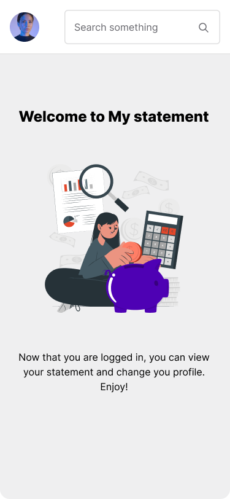
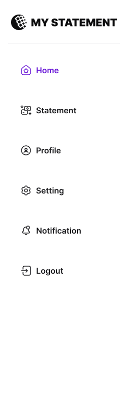

# Dashboard and navigation drawer

**Track:** mobile · **Difficulty:** intermediate · **Estimated:** 5h  
**Prerequisites:** [`mobile-02-login`](../mobile-02-login/spec.md)

## Objective

Build the authenticated shell: a top bar, a slide-in navigation drawer, and a
guarded navigation stack.

## Design

[Open this screen in Figma](https://www.figma.com/file/Q44nlEVrODE7W6iBFRVPZL/Desafio-para-devs---App-%2F-Dashboard-%7C-UX%2FUI?node-id=13-4267)




Design system: [`../../design/style-guide.md`](../../design/style-guide.md) · tokens: [`../../design/tokens.json`](../../design/tokens.json)

## What you build

The **Home** screen plus the **drawer** from the mobile design.

**Top bar**: the user's circular avatar and a "Search something" input. No
sidebar — navigation lives in the drawer.

**Drawer** (256px wide, from `menu-mobile.png`): logo, then Home · Statement ·
Profile · Setting · Notification · Logout. The active item is purple.

**Content**: "Welcome to My statement", the illustration, and the caption from
the design.

## Navigation

| Destination | Contents |
|---|---|
| Home | this screen |
| Statement | placeholder — filled in by `mobile-04-statement` |
| Profile | placeholder — filled in by `mobile-05-profile-edit` |

## Requirements

- **Guard the stack.** Launching without a stored token lands on login.
- **Logout** clears secure storage and resets the navigation stack, so the
  hardware back button cannot return to an authenticated screen.
- Setting, Notification and Search are decorative — the API does not back them.
  Render them, wire them to nothing, and say so in your README.
- The drawer must be dismissible by swipe and by tapping the scrim.

## Test IDs

Expose these as `data-testid` (web) or the platform accessibility identifier (mobile). They are the contract that lets the harness verify your UI without dictating your framework.

```
app-shell
drawer
drawer-toggle
nav-home
nav-statement
nav-profile
topbar
avatar
logout
welcome-heading
```

## Acceptance criteria

See [`acceptance.md`](acceptance.md) — 6 criteria (`MOB03-AC1`…`MOB03-AC6`).

## Verifying your work

⚠️ **This challenge is not automatically verified.** Native mobile UI cannot be checked the way an HTTP API or a browser page can, so the criteria in `acceptance.md` are a self-review checklist. Optional [Maestro](https://maestro.mobile.dev/) flows live in `harness/ui/mobile/` if you want to automate part of it.

## Final considerations

- Write a README that says how to run your project, what you chose and why.
- Handle the error paths, not just the happy one.
- Tests are not required, but they are the clearest signal you can send.
- If something in this spec is ambiguous or wrong, [open an issue](https://github.com/micheltlutz/dev-challenge/issues/new/choose) — fixing the spec is a real contribution.
