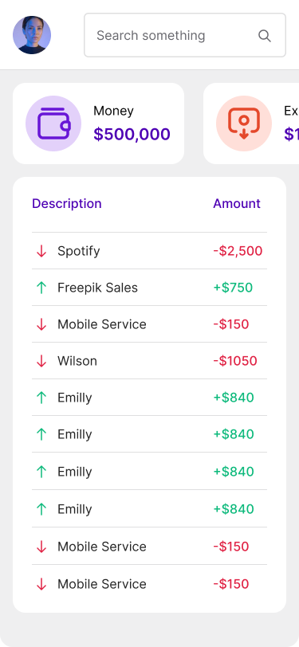

# Statement list, balance and pagination

**Track:** mobile · **Difficulty:** advanced · **Estimated:** 6h  
**Prerequisites:** [`mobile-03-dashboard`](../mobile-03-dashboard/spec.md)

## Objective

The most substantial screen in the mobile track: balance, a horizontally
scrolling KPI carousel, an infinite or paged transaction list, and a control
that hides monetary values.

## Design

[Open this screen in Figma](https://www.figma.com/file/Q44nlEVrODE7W6iBFRVPZL/Desafio-para-devs---App-%2F-Dashboard-%7C-UX%2FUI?node-id=19-1283)




Design system: [`../../design/style-guide.md`](../../design/style-guide.md) · tokens: [`../../design/tokens.json`](../../design/tokens.json)

## What you build

The **Statement** screen from the mobile design.

### Balance and KPI carousel

Fetch `GET /balance/`. Show the amount as the headline figure, then a
horizontally scrolling row of cards — **Money**, **Expenses**, **Earnings** —
where the next card is partially visible at the screen edge, as the mockup
shows. Only Money is API-backed; derive the other two from the fetched
statements and note that in your README.

### Hide values

A toggle (`balance-toggle`) masks every monetary value — balance, KPI values and
every row amount — with something like `••••••`. Drawn in
[`wireframe-statement.png`](../../../readme_files/images/wireframe-statement.png)
as the crossed-out eye. Required, and it must persist across an app restart.

### Transaction list

Fetch `GET /statements/?skip=<n>&limit=<size>`. The mobile design uses a compact
two-column row: description block on the left, amount on the right.

- Credits: `--color-semantic-credit`, `+`, `↑`. Debits:
  `--color-semantic-debit`, `-`, `↓`.
- Paginate by **infinite scroll** — load the next page as the user nears the
  end — or with an explicit control. Either is fine; infinite scroll matches the
  platform better.
- Show `statement-loading` while a page is in flight and `statement-empty` when
  there are no rows at all.

## Requirements

- Colour must not be the only credit/debit signal — keep the arrow and sign.
- Amounts must be reachable by the platform screen reader with their sign
  announced.
- Pull-to-refresh resets to the first page.

## Test IDs

Expose these as `data-testid` (web) or the platform accessibility identifier (mobile). They are the contract that lets the harness verify your UI without dictating your framework.

```
balance-amount
balance-toggle
kpi-carousel
kpi-money
kpi-expenses
kpi-earnings
statement-list
statement-row
statement-amount
statement-empty
statement-loading
```

## Acceptance criteria

See [`acceptance.md`](acceptance.md) — 8 criteria (`MOB04-AC1`…`MOB04-AC8`).

## Verifying your work

⚠️ **This challenge is not automatically verified.** Native mobile UI cannot be checked the way an HTTP API or a browser page can, so the criteria in `acceptance.md` are a self-review checklist. Optional [Maestro](https://maestro.mobile.dev/) flows live in `harness/ui/mobile/` if you want to automate part of it.

## Final considerations

- Write a README that says how to run your project, what you chose and why.
- Handle the error paths, not just the happy one.
- Tests are not required, but they are the clearest signal you can send.
- If something in this spec is ambiguous or wrong, [open an issue](https://github.com/micheltlutz/dev-challenge/issues/new/choose) — fixing the spec is a real contribution.
