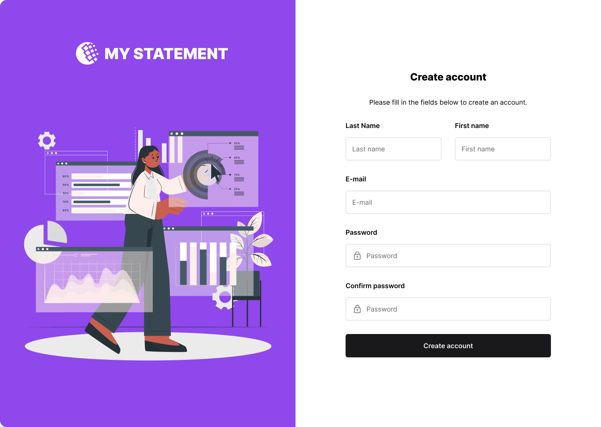

# Create account form

**Track:** web · **Difficulty:** starter · **Estimated:** 4h  
**Prerequisites:** [`web-01-contact-form`](../web-01-contact-form/spec.md)

## Objective

Build the sign-up screen to the design, and register the user through the API.
This is your first design-fidelity challenge: the split panel, the near-black
button and the two-up name row are all part of the brief.

## Design

[Open this screen in Figma](https://www.figma.com/file/Q44nlEVrODE7W6iBFRVPZL/Desafio-para-devs---App-%2F-Dashboard-%7C-UX%2FUI?node-id=1-655)



Design system: [`../../design/style-guide.md`](../../design/style-guide.md) · tokens: [`../../design/tokens.json`](../../design/tokens.json)

## What you build

The **Create account** screen from the design.

Layout (desktop 1440×1024): a 50/50 split — purple panel with the "MY
STATEMENT" wordmark and illustration on the left, white form card on the right.
Below the tablet breakpoint the panel collapses and only the form remains.

Fields, in the order the mockup shows them:

1. **Last Name** and **First name**, side by side
2. **E-mail**
3. **Password**
4. **Confirm password**
5. **Date of birth**

Primary button: **Create account**, full width, `--color-action-default`.
Below it, a link to the login screen.

### On submit

The API takes a single `fullname`, so join the two name fields:

```http
POST /users/
Content-Type: application/json

{
  "userid": "<e-mail>",
  "password": "<password>",
  "fullname": "<First name> <Last Name>",
  "birthdate": "YYYY-MM-DD"
}
```

| Response | What to do |
|---|---|
| 201 | show success, then send the user to the login screen |
| 400 | the e-mail is taken — show it on the e-mail field |
| 422 | show per-field validation errors |

## Requirements

- **Confirm password** must match before anything is sent.
- Convert the date to ISO `YYYY-MM-DD` regardless of how you display it.
- Use the tokens in [`../../design/tokens.css`](../../design/tokens.css).

## Test IDs

Expose these as `data-testid` (web) or the platform accessibility identifier (mobile). They are the contract that lets the harness verify your UI without dictating your framework.

```
signup-form
signup-firstname
signup-lastname
signup-email
signup-password
signup-confirm-password
signup-birthdate
signup-submit
signup-error
signup-success
link-login
```

## Acceptance criteria

See [`acceptance.md`](acceptance.md) — 7 criteria (`WEB02-AC1`…`WEB02-AC7`).

## Verifying your work

```bash
# Linux
docker run --rm --network host ghcr.io/micheltlutz/dev-challenge-harness \
  --base-url http://localhost:8000 --challenge web-02-create-account

# macOS / Windows
docker run --rm ghcr.io/micheltlutz/dev-challenge-harness \
  --base-url http://host.docker.internal:8000 --challenge web-02-create-account
```

See [`../../../harness/README.md`](../../../harness/README.md) for the UI runner and other options.

## Final considerations

- Write a README that says how to run your project, what you chose and why.
- Handle the error paths, not just the happy one.
- Tests are not required, but they are the clearest signal you can send.
- If something in this spec is ambiguous or wrong, [open an issue](https://github.com/micheltlutz/dev-challenge/issues/new/choose) — fixing the spec is a real contribution.
