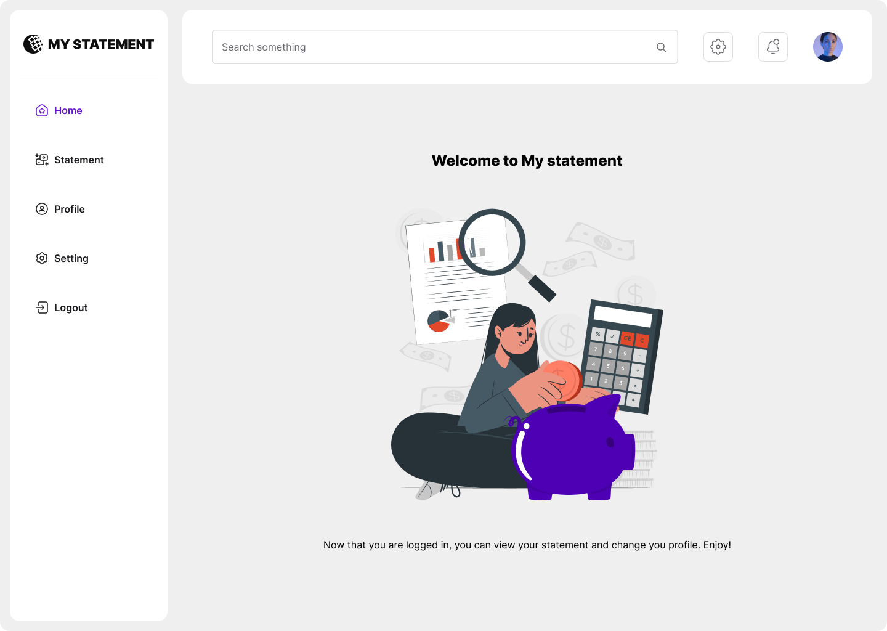

# Dashboard shell

**Track:** web · **Difficulty:** intermediate · **Estimated:** 5h  
**Prerequisites:** [`web-03-login`](../web-03-login/spec.md)

## Objective

Build the application shell every authenticated screen lives inside: sidebar,
top bar, and a guarded route tree. No new API calls -- this challenge is layout
and navigation.

## Design

[Open this screen in Figma](https://www.figma.com/file/Q44nlEVrODE7W6iBFRVPZL/Desafio-para-devs---App-%2F-Dashboard-%7C-UX%2FUI?node-id=13-3891)



Design system: [`../../design/style-guide.md`](../../design/style-guide.md) · tokens: [`../../design/tokens.json`](../../design/tokens.json)

## What you build

The **Home** screen from the design.

**Sidebar** (256px, white): logo, then Home · Statement · Profile · Setting ·
Logout. The active item is purple.

**Top bar** (72px): a "Search something" input, a gear button, a bell button,
and the user's circular avatar.

**Content**: the heading "Welcome to My statement", the illustration, and the
caption "Now that you are logged in, you can view your statement and change you
profile. Enjoy!"

## Routes

| Route | Contents |
|---|---|
| `/` or `/home` | this screen |
| `/statement` | empty placeholder — filled in by `web-05-statement` |
| `/profile` | empty placeholder — filled in by `web-06-profile-edit` |

## Requirements

- **Guard the routes.** Reaching any of them without a stored token must
  redirect to login.
- **Logout** clears the token and returns to login.
- Setting, Notification and Search are **decorative** — the API does not back
  them. Render them, wire them to nothing, and say so in your README.
- Responsive: below the tablet breakpoint the sidebar becomes a drawer.

## Test IDs

Expose these as `data-testid` (web) or the platform accessibility identifier (mobile). They are the contract that lets the harness verify your UI without dictating your framework.

```
app-shell
sidebar
nav-home
nav-statement
nav-profile
topbar
topbar-search
avatar
logout
welcome-heading
```

## Acceptance criteria

See [`acceptance.md`](acceptance.md) — 7 criteria (`WEB04-AC1`…`WEB04-AC7`).

## Verifying your work

```bash
# Linux
docker run --rm --network host ghcr.io/micheltlutz/dev-challenge-harness \
  --base-url http://localhost:8000 --challenge web-04-dashboard

# macOS / Windows
docker run --rm ghcr.io/micheltlutz/dev-challenge-harness \
  --base-url http://host.docker.internal:8000 --challenge web-04-dashboard
```

See [`../../../harness/README.md`](../../../harness/README.md) for the UI runner and other options.

## Final considerations

- Write a README that says how to run your project, what you chose and why.
- Handle the error paths, not just the happy one.
- Tests are not required, but they are the clearest signal you can send.
- If something in this spec is ambiguous or wrong, [open an issue](https://github.com/micheltlutz/dev-challenge/issues/new/choose) — fixing the spec is a real contribution.
