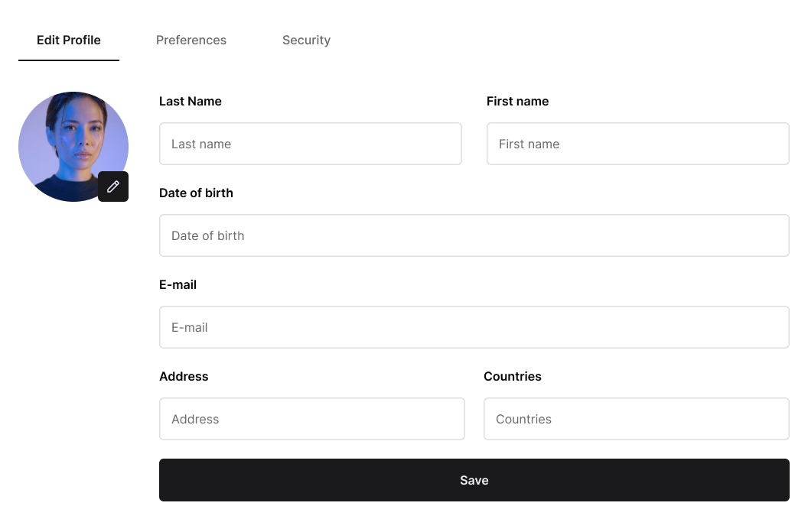

# Edit profile

**Track:** web · **Difficulty:** advanced · **Estimated:** 4h  
**Prerequisites:** [`web-04-dashboard`](../web-04-dashboard/spec.md)

## Objective

Build the profile screen and persist changes. Half the fields in the mockup are
not backed by the API — deciding what to do about that is the challenge.

## Design

[Open this screen in Figma](https://www.figma.com/file/Q44nlEVrODE7W6iBFRVPZL/Desafio-para-devs---App-%2F-Dashboard-%7C-UX%2FUI?node-id=19-3597)



Design system: [`../../design/style-guide.md`](../../design/style-guide.md) · tokens: [`../../design/tokens.json`](../../design/tokens.json)

## What you build

The **Edit Profile** screen from the design: three tabs (Edit Profile,
Preferences, Security) with the first active, a circular avatar with a black
pencil badge, then the form and a full-width **Save**.

### Finding your own user id

`PUT /users/{user_id}` needs a numeric id, and the token only carries your
e-mail. Fetch it first:

```http
GET /users/me
Authorization: Bearer <access_token>
```

```json
{ "id": 3, "userid": "ada@example.com", "fullname": "Ada Lovelace", "birthdate": "1815-12-10" }
```

Use the same response to prefill the form.

### Backed by the API

| Field | Notes |
|---|---|
| Last Name / First name | joined into `fullname` on save |
| Date of birth | ISO `YYYY-MM-DD` |
| E-mail | **read-only** — `userid` cannot be changed |

### Not backed by the API

Address · Countries · avatar upload · the Preferences and Security tabs.

Render them as the design shows, keep them non-functional or client-side only,
and list them under a "Known limitations" heading in your README. Silently
dropping them is wrong; pretending they save is worse.

### On save

```http
PUT /users/{user_id}
Authorization: Bearer <access_token>
Content-Type: application/json

{ "fullname": "First Last", "birthdate": "YYYY-MM-DD" }
```

Send only what changed. On 200 show `profile-success` and update the shell's
avatar and name.

## Requirements

- Prefill the form with the current profile.
- Disable **Save** until something actually changes.
- A 401 clears the session and returns to login.

## Test IDs

Expose these as `data-testid` (web) or the platform accessibility identifier (mobile). They are the contract that lets the harness verify your UI without dictating your framework.

```
profile-tabs
profile-form
profile-avatar
profile-firstname
profile-lastname
profile-email
profile-birthdate
profile-save
profile-success
profile-error
```

## Acceptance criteria

See [`acceptance.md`](acceptance.md) — 7 criteria (`WEB06-AC1`…`WEB06-AC7`).

## Verifying your work

```bash
# Linux
docker run --rm --network host ghcr.io/micheltlutz/dev-challenge-harness \
  --base-url http://localhost:8000 --challenge web-06-profile-edit

# macOS / Windows
docker run --rm ghcr.io/micheltlutz/dev-challenge-harness \
  --base-url http://host.docker.internal:8000 --challenge web-06-profile-edit
```

See [`../../../harness/README.md`](../../../harness/README.md) for the UI runner and other options.

## Final considerations

- Write a README that says how to run your project, what you chose and why.
- Handle the error paths, not just the happy one.
- Tests are not required, but they are the clearest signal you can send.
- If something in this spec is ambiguous or wrong, [open an issue](https://github.com/micheltlutz/dev-challenge/issues/new/choose) — fixing the spec is a real contribution.
